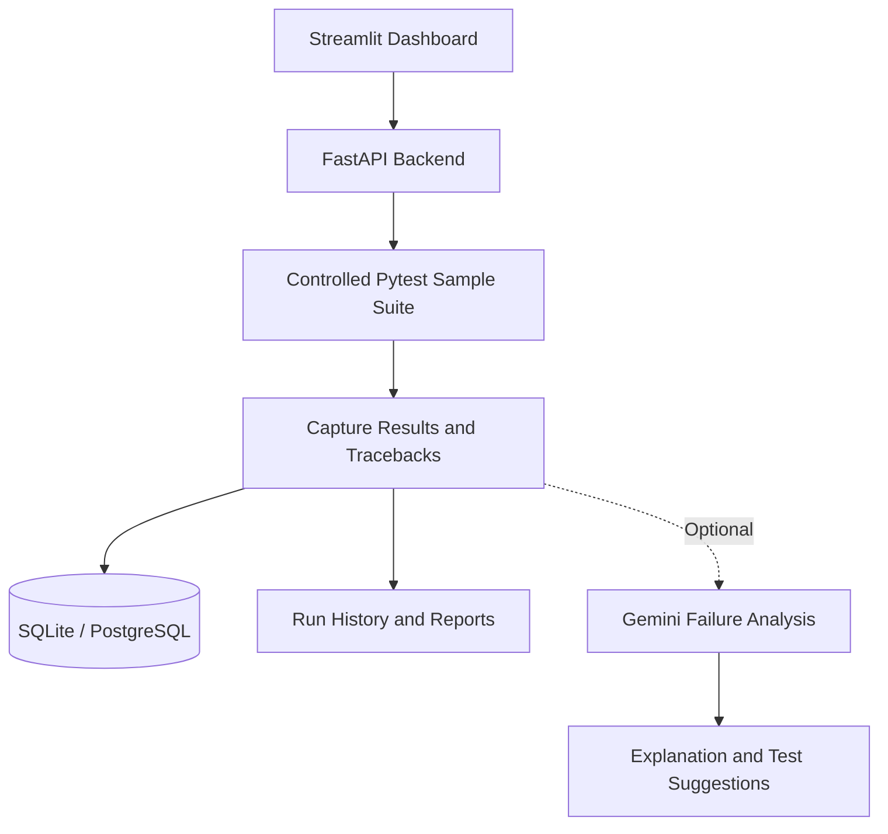

<div align="center">

# 🧪 TestPilot AI
### AI-Powered Test Analysis Platform

**Find failures. Understand errors. Improve your testing workflow.**

A Python-powered testing dashboard that runs a controlled Pytest suite, records test history, and can use AI to explain failures in beginner-friendly language.

<br/>


<br/>


</div>

---

## 🌟 Overview

**TestPilot AI** brings test execution, failure inspection, and AI-assisted explanations into one simple workflow.

Run the bundled sample tests, review actual results and tracebacks, explore previous runs, and optionally ask Gemini to explain a failure or suggest additional tests.

> [!IMPORTANT]
> **Project status:** Prepared for deployment; no public demo URL is available yet.  
> **Safe execution scope:** The app runs the bundled sample test suite only. It does not accept or execute visitor-uploaded code.

## ✨ Features

<table>
<tr>
<td width="50%">

### 🚀 Test Execution
Run the bundled Pytest suite and capture pass, fail, skip, and error counts.

</td>
<td width="50%">

### 🧠 AI Failure Analysis
Optionally use Gemini to explain tracebacks and suggest additional tests.

</td>
</tr>
<tr>
<td width="50%">

### 📊 Dashboard
Review summary metrics, recent activity, and test-run details.

</td>
<td width="50%">

### 🕘 Test History
Keep test-run records and inspect previous results and tracebacks.

</td>
</tr>
<tr>
<td width="50%">

### 📄 Exportable Reports
Export individual test-run details as JSON.

</td>
<td width="50%">

### 🛡️ Controlled Execution
Use a fixed sample-project path, timeout, output cap, and basic rate limiting.

</td>
</tr>
</table>

**Note:** AI analysis is optional. AI-generated explanations and suggestions are advisory, not verified fixes, and do not change the actual Pytest result.

## 🧰 Tech Stack

| Component | Technology |
|:--|:--|
| Language | Python |
| Dashboard | Streamlit |
| REST API | FastAPI |
| Test automation | Pytest |
| Database / ORM | SQLite, SQLAlchemy |
| Migrations | Alembic |
| Optional AI integration | Google Gemini API |

## 🔍 How It Works



1. Launch the API and dashboard.
2. Run the bundled sample test suite.
3. TestPilot records results, duration, and output.
4. Review the run history and traceback.
5. If Gemini is configured, request an explanation or additional test ideas.

The sample suite contains a passing test and an intentionally failing test so you can inspect a real failure and traceback.

## 📁 Project Structure

```text
TestPilot AI/
├── backend/
│   ├── app/               # FastAPI application and routes
│   ├── migrations/        # Alembic migrations
│   ├── sample_project/    # Controlled Pytest sample suite
│   └── tests/             # Backend tests
├── frontend/
│   └── app.py             # Streamlit dashboard
├── requirements.txt
├── render.yaml
└── README.md
```

## ⚙️ Getting Started

### Requirements

- Windows 10/11
- Git
- Python 3.12 recommended

### 1. Set up the environment

Run from the project root in PowerShell:

```powershell
py -3.12 -m venv .venv
.\.venv\Scripts\Activate.ps1
python -m pip install --upgrade pip
pip install -r requirements.txt
Copy-Item .\backend\.env.example .\backend\.env
Copy-Item .\frontend\.env.example .\frontend\.env
```

### 2. Start the backend

Open a PowerShell terminal at the project root:

```powershell
Set-Location .\backend
python -m uvicorn app.main:app --reload --host 127.0.0.1 --port 8000
```

API documentation: **http://127.0.0.1:8000/docs**

### 3. Start the dashboard

Open a **second** PowerShell terminal at the project root:

```powershell
.\.venv\Scripts\Activate.ps1
Set-Location .\frontend
python -m streamlit run app.py
```

Open **http://localhost:8501** in your browser.

The dashboard uses `TESTPILOT_API_URL`, which defaults to `http://127.0.0.1:8000/api`.

### 4. Enable AI analysis (optional)

TestPilot works without an AI key. To enable Gemini, add `GEMINI_API_KEY` privately to `backend/.env` and set `AI_MODEL` to a model available to your account.

🔐 **Never commit API keys or put them in frontend environment variables.**

## 🧪 Run Tests

With the virtual environment active, run from the project root:

```powershell
python -m pytest .\backend\tests
```

Check the dashboard file syntax:

```powershell
python -m compileall -q .\frontend\app.py
```

## ☁️ Deployment

A Render blueprint is included in `render.yaml` for the backend and Streamlit dashboard. The project is **not yet deployed publicly**.

Before deploying:

1. Configure a persistent PostgreSQL database for hosted history.
2. Set the backend environment variables in the hosting provider.
3. Set the dashboard's `TESTPILOT_API_URL` to the deployed API URL plus `/api`.
4. Deploy both services and verify the health endpoint and sample test run.

Review current hosting-provider limits before deployment. Hosted filesystems may be ephemeral, so SQLite should not be relied on for persistent hosted history.

## 🔒 Security & Limitations

- Only the bundled sample suite is executed; arbitrary commands, paths, and uploaded code are not accepted.
- Test execution has a configured timeout and output cap.
- Rate limiting is process-local and is only a basic demo safeguard.
- The current demo has no authentication or per-user workspace isolation.
- AI output is advisory text, not a verified patch.
- Do not submit private source code, credentials, or sensitive logs.

## 🛣️ Future Improvements

- 🔑 Authentication and isolated user workspaces
- 📦 Sandboxed execution for approved external projects
- 🩹 Human-reviewed patch previews and verified fix workflows
- 📈 Persistent rate limiting, audit logs, and CI integration

## 👩‍💻 Author

<div align="center">

### **Amulya Munugoti**

*Building practical tools with Python, testing, and AI-assisted workflows.*

**ALL RIGHTS RESERVED BY AMULYA MUNUGOTI**

</div>
